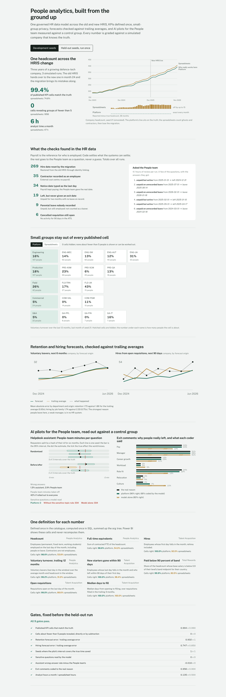

# people-analytics-foundation

People analytics built from the ground up for a fast-growing defence-tech company (fictional, about 200 people
growing towards 450 in Germany, the UK and Ukraine) in the middle of an HRIS change.

It builds one governed HR data model from the old HRIS, the new HRIS, payroll and the ATS. It defines every KPI once,
as code, and publishes them to leaders with small-group privacy. It forecasts retention and hiring and checks both
against trailing averages. It runs two AI pilots for the People team, a helpdesk assistant and exit-comment coding,
and measures them against a control group.

Every number is graded against the truth of a simulated company. The world knows who really left, when and why, and
which records the systems got wrong. The platform only sees what the systems recorded.

I built it for the ARX Robotics People Analytics & AI Optimization Expert application. The company, its people and
its policies are fictional. See [Limits](#limits).



## Results

Every design reads the same exports about the same company, and meets the same model mistakes.

<!-- results:start -->

_Generated from `reports/*.json` by `python -m paf.cli report`._

**Development seeds** (seeds [21, 22, 23])

| Design | KPI cells right | Small groups revealed | Retention error vs trailing average | Hiring error vs trailing average | People-team minutes per question, true / estimated (95% CI per seed) | Wrong answers: assistant vs People team | Sensitive questions read by a model | Exit reasons coded right | Analyst hours a month |
|---|---:|---:|---:|---:|---:|---:|---:|---:|---:|
| Spreadsheets: an export from each system, an analyst's definitions, every cell shared | 74.8% | 1656 | 1.00x | 1.00x | no pilot | — vs 2.9% | 0 | 92.3% | 47.4 |
| people-analytics-foundation | 99.4% | 0 | 0.93x | 0.75x | -5.0 / -5.4 ([-6.9, -4.1], [-6.7, -4.1], [-6.7, -3.9]) | 1.3% vs 2.9% | 0 | 95.6% | 6.4 |
| Same data, AI without guardrails (no sensitive-topic rule, no checks) | 99.4% | 0 | 0.93x | 0.75x | -11.9 / -12.1 ([-13.4, -11.8], [-12.1, -10.8], [-13.0, -11.5]) | 29.3% vs 2.9% | 334 | 79.9% | 6.4 |

Gates: all 9 pass.

**Held-out seeds, run once** (seeds [201, 202])

| Design | KPI cells right | Small groups revealed | Retention error vs trailing average | Hiring error vs trailing average | People-team minutes per question, true / estimated (95% CI per seed) | Wrong answers: assistant vs People team | Sensitive questions read by a model | Exit reasons coded right | Analyst hours a month |
|---|---:|---:|---:|---:|---:|---:|---:|---:|---:|
| Spreadsheets: an export from each system, an analyst's definitions, every cell shared | 68.7% | 592 | 1.00x | 1.00x | no pilot | — vs 2.9% | 0 | 97.6% | 49.0 |
| people-analytics-foundation | 99.8% | 0 | 0.98x | 0.90x | -4.5 / -4.8 ([-5.6, -3.1], [-6.6, -4.2]) | 1.5% vs 2.9% | 87 | 100.0% | 6.7 |
| Same data, AI without guardrails (no sensitive-topic rule, no checks) | 99.8% | 0 | 0.98x | 0.90x | -11.8 / -11.9 ([-12.4, -11.1], [-12.6, -11.5]) | 30.4% vs 2.9% | 266 | 69.3% | 6.7 |

Gates: 7 of 9 pass. FAILED: Hiring forecast error / trailing-average error; Sensitive questions read by the model

**What the checks found in the HR data** (development seeds)

| What the checks found | Records, all seeds |
|---|---:|
| Hire date reset to go-live by the migration, restored from the old HRIS | 269 |
| Contractor recorded as an employee (external cost centre) | 35 |
| Notice date typed as the last day (still paid afterwards) | 34 |
| Left, but never given an exit date (no payroll since) | 19 |
| Unpaid because of parental leave nobody recorded | 9 |
| Requisition cancelled but still open in the ATS | 6 |

<!-- results:end -->

The full tables are in [REPORT.md](REPORT.md):
- every ablation;
- KPI accuracy by KPI;
- exit reasons, real against coded;
- the pilot read out randomised against before/after.

## How it works

```
old HRIS ─┐                                  ┌─ KPIs as code (DuckDB SQL) ─ small-group privacy ─ console / Power BI
new HRIS ─┼─ adapters ─ identity ─ checks ───┤─ retention + hiring forecasts (checked against trailing averages)
payroll  ─┤  (refuse     (one worker   │     └─ People-team questions about the data (review queue)
ATS      ─┘   unknowns)   across both) │
                         payroll: left? unrecorded leave? still paid after the "last day"?
helpdesk question ─ sensitive topic? ─ person │ else model picks + quotes a passage ─ code checks ─ answer or person
exit comment ─ model names a theme + quotes it ─ code checks the quote, the theme cue, praise ─ coded or person
```

| Part | File | What it does |
|---|---|---|
| Adapters | `platform/records.py` | Read the old HRIS (German fields, dotted dates), the new HRIS, payroll and the ATS. An unknown department or org unit becomes a question for the People team, never a guess. |
| Identity | `platform/records.py` | Links a person's old-HRIS employment to their new-HRIS record by name and birth date; rehires keep separate employments. |
| Checks | `platform/records.py` | Restores hire dates the migration reset; reclassifies contractors on external cost centres; finds leavers with no exit date and wrong last days from payroll; tells unrecorded parental leave apart from leaving; closes stale requisitions. |
| KPIs | `platform/kpis.py`, `config/kpis.yml` | Additive components per team and month in SQL, summed up the org tree, each KPI computed from sums at every level (never an average of averages). |
| Privacy | `platform/kpis.py` | Hides any cell about fewer than 5 people, and a sibling where one hidden cell could otherwise be worked out by subtraction. |
| Forecasts | `platform/forecast.py` | Retention: logistic model of voluntary exits by person-month (tenure, pay against band, season, the team's recent exits). Hiring: Kaplan-Meier time-to-fill by job family over open requisitions. Only data dated before the origin. |
| Pilots | `platform/pilots.py`, `platform/readers.py` | The helpdesk assistant and exit coding with their checks; assignment by a hash of the requester; difference in means with a bootstrap over requesters. Claude and OpenAI-compatible adapters. |
| Power BI | `lab/bi.py`, `bi/` | A star schema of the published cells and DAX measures generated from the catalogue. |
| World | `world/` | The company, the systems and their mistakes, what people write, the model's mistakes, the People team's answers. |

## Limits

- **Everything is simulated:** the company, its people, their reasons, the HRIS mistakes, the questions and the
  model's mistakes. The numbers compare designs under these assumptions; they do not forecast any real company.
- **The model's mistakes are chosen, not measured.** The Claude and OpenAI-compatible adapters are tested against a
  fake transport only.
- **The checks were written knowing the kinds of mistakes the world makes.** The held-out world makes them more often
  and adds a new country, new phrasings and faster growth; it does not add new kinds of mistakes.
- **Two word lists saw the held-out phrasings** (ADR 0007): the exit-coding cues and the helpdesk topic words. The
  held-out exit-coding accuracy and assistant wrong-answer rate are not out-of-sample results.
- **What the held-out run showed** (ADR 0007):
  - The sensitive-topic keyword rule let 87 sensitive questions reach the model; the checks still stopped every
    answer to them from going out.
  - The hiring forecast missed its gate as the company grew faster.
  - The retention model barely beat a trailing average.
- **Power BI:** `bi/` holds a star schema and generated DAX. I have not opened it in Power BI.
- **No real HRIS:** the exports imitate a Personio-style old system and a Workday-style new one; no vendor API is
  called.
- **Works council and data protection:** the design keeps people below 5 out of every published cell and keeps
  sensitive questions away from the model. A real rollout needs a works-council agreement, a DPIA and a documented
  purpose for each use of employee data. None of that is in this repository.
- **The retention model is modest by design:** the strongest real cause of leaving in this world, a weak manager, is
  not in any HR system.

## Run it

```
pip install -e ".[dev]"
pytest -q
python -m paf.cli run dev && python -m paf.cli gate dev && python -m paf.cli report
cd web && npm ci && npm run dev
```

## Repository map

`AGENTS.md` (invariants and the held-out rule), `CLAUDE.md`, `SKILLS.md`, `docs/adr/`, `config/` (world, platform,
KPIs, designs, seeds, gates), `src/paf/` (world, platform, lab), `reports/`, `bi/`, `web/`.
